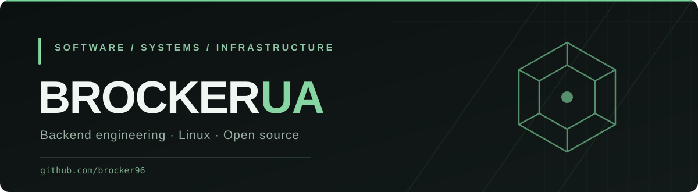

  

   

  
  
  

 

<table>
<tr>
<td width="62%" valign="top">

### About

**BrockerUA** · `brocker96`

Software developer and QA engineer working across backend systems, infrastructure, and product engineering.

I focus on practical architecture, measurable performance improvements, reliable operations, and interfaces that make complex systems easier to manage.

**Areas of interest**

`Backend engineering` · `Linux` · `Infrastructure` · `Networking` · `Security` · `Developer tools`

</td>
<td width="38%" valign="top">

### Currently

**Building**  
Raptor Panel — open-source game server management.

**Exploring**  
Infrastructure automation, security, and systems design.

**Working with**  
Laravel, React, TypeScript, Docker, Redis, Linux.

</td>
</tr>
</table>

## Selected work

<table>
<tr>
<td width="50%" valign="top">

### [Raptor Panel](https://github.com/brocker96/raptor-panel)

**Game server management, re-engineered.**

An open-source panel focused on performance, a cohesive administration experience, and operational tooling.

`Laravel` `React` `TypeScript` `Vite` `Docker`

</td>
<td width="50%" valign="top">

### PingUp

**A messaging platform in development.**

An exploration of real-time communication, responsive interfaces, and the architecture behind modern messaging products.

`Real-time systems` `UI/UX` `Product engineering`

</td>
</tr>
</table>

### Raptor Panel — engineering highlights

| Area | Engineering work |
| :-- | :-- |
| Backend | Reduced server-list SQL queries from **340 to 15** in a development benchmark |
| API | Reduced server-list response time from **191 ms to 39 ms** in the same benchmark |
| Data access | Optimized an activity-log query from **551 ms to 0.5 ms** on a test dataset |
| Frontend | Migrated the build to **Vite 8** and modernized the React application |
| Administration | Built a dedicated administration interface, diagnostics, and integrated guides |
| Operations | Developed installation, update, and migration workflows |

Benchmark figures are from development tests, not cross-project comparisons or production guarantees.

## Technology

**Languages & frameworks**

  

**Systems & tooling**

 

## GitHub activity

  
  

 

  BUILD SYSTEMS THAT LAST. OPTIMIZE WHAT MATTERS.

